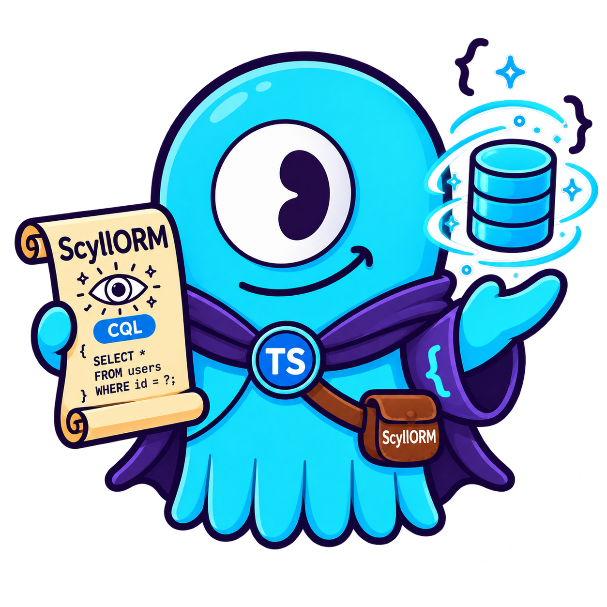

# Scyllorm - TypeScript ORM for ScyllaDB & Apache Cassandra

[](https://www.npmjs.com/package/scyllorm)
[](https://www.npmjs.com/package/scyllorm)
[](https://github.com/tfmf/scyllorm/actions/workflows/ci.yml)
[](https://github.com/tfmf/scyllorm/actions/workflows/ci.yml)
[](https://github.com/tfmf/scyllorm/blob/main/LICENSE)

<p align="left">
  
</p>

Welcome to **Scyllorm**—an experimental TypeScript ORM for ScyllaDB and Apache Cassandra that’s so fresh, it’s practically still in beta diapers. We’ve set out to simplify database interactions in Node.js. By “simplify,” we mean it’s highly opinionated, so prepare to adopt our opinions, or go find another ORM. Features? Yeah, we’ve got some—just not all of them (yet). A few are stuck in the backlog, and others are on the database’s “no-can-do” list.

Under the hood we use the Node.js [Cassandra driver](https://github.com/datastax/nodejs-driver/), and every statement Scyllorm generates is standard CQL 3—no Scylla-only extensions. That makes **both ScyllaDB and Apache Cassandra (3.x/4.x) first-class citizens**: same API, same CQL, pick whichever keeps your pager quieter.

Oh, and we’re currently rolling with the [Data Mapper Pattern](https://en.wikipedia.org/wiki/Data_mapper_pattern) because it’s what all the cool ORMs are doing. Maybe someday we’ll add the [Active Record Pattern](https://en.wikipedia.org/wiki/Active_record_pattern), but we’re still debating whether we like our records active or not.

## Prerequisites 🎒

-  **Node.js:** If you don't have this, you might be in the wrong place.
-  **Docker:** The easiest way to spin up ScyllaDB locally without accidentally summoning Cthulhu.

## Installation 🚀

To install Scyllorm, just hit it with the good ol’ NPM:

```bash
npm install scyllorm
```

(https://www.npmjs.com/package/scyllorm)

## Step-by-Step Guide 🛠

### 1. Summon ScyllaDB via Docker 🐳

**Docker:**

```bash
docker run -d \
  -p 9042:9042 \
  --cpus 2 \
  --memory 2g \
  scylladb/scylla:latest \
  --smp 2 \
  --memory=2G \
  --overprovisioned 1 \
  --authenticator PasswordAuthenticator \
  --authorizer CassandraAuthorizer \
  --max-clustering-key-restrictions-per-query 1500
```

**docker-compose:**

```bash
  core_scylladb:
    container_name: scylladb_server
    image: scylladb/scylla:latest
    ports:
      - "9042:9042" # CQL
    command: --smp 2 --memory=2G --overprovisioned 1 --authenticator PasswordAuthenticator --authorizer CassandraAuthorizer --max-clustering-key-restrictions-per-query 1500
    volumes:
      - ./scylladb_data:/var/lib/scylla
```

### 2. Test Your Connection 🎯

- For a friendly UI, try [DbVisualizer Free](https://www.dbvis.com/).
- Or, if you're feeling hardcore, dive into the terminal:

```bash
docker exec -it scylladb_server cqlsh -u cassandra -p cassandra
```

### 3. Create a Test Table 🛠️

Because what’s a database without a table?

```cql
CREATE KEYSPACE test_keyspace WITH REPLICATION = {'class': 'SimpleStrategy', 'replication_factor': 1} AND durable_writes = true;

USE test_keyspace;

CREATE TABLE employees (
  id int,
  first_name text,
  last_name text,
  age int,
  city text,
  created_at timestamp,
  updated_at timestamp,
  deleted_at timestamp,
  PRIMARY KEY (id, first_name)
);

CREATE INDEX employees_first_first_name_idx ON employees (first_name);
CREATE INDEX employees_first_last_name_idx ON employees (last_name);
```

Allergic to hand-written DDL? Your entities can generate all of this for you — see §10, Schema Synchronization.

### 4. Create Your Model 🎨

Now, let’s make a model:

```typescript
import { BaseModel, Column, Entity, Index, PrimaryKeyColumn } from 'scyllorm';

@Entity('employees')
@Index('employees_first_first_name_idx', 'first_name')
@Index('employees_first_last_name_idx', 'last_name')
export class Employee extends BaseModel {
    @PrimaryKeyColumn('INT', { partitionKey: true })
    id: number;

    @PrimaryKeyColumn('TEXT', { clusteringKey: true })
    first_name: string;

    @Column('TEXT')
    last_name: string;

    @Column('INT', { default: 0 })
    age: number;

    @Column('TEXT', { default: 0 })
    city: string;

    @Column('TIMESTAMP', { default: () => new Date() })
    created_at: Date;

    @Column('TIMESTAMP', { default: () => new Date() })
    updated_at: Date;

    @Column('TIMESTAMP')
    deleted_at: Date | null;
}
```

### 5. Setup the DataSource 🛢

This is where the magic happens:

```typescript
import { DataSource } from 'scyllorm';

const dataSource = new DataSource({
    contactPoints: ['localhost'], // Change this if your setup is fancier
    localDataCenter: 'datacenter1',
    keyspace: 'test_keyspace',
    credentials: {
        username: 'cassandra',
        password: 'cassandra',
    },
    protocolOptions: { port: 9042 },
});
```

### 6. Use the Repository 🛠

Now, let’s put this thing to work:

```typescript
async function run() {
    try {
        await dataSource.initialize();

        const repository = dataSource.getRepository(Employee);

        const employee = new Employee();
        employee.id = 1;
        employee.first_name = 'John';
        employee.last_name = 'Doe';
        employee.age = 30;
        employee.city = 'New York';

        const employee2 = new Employee();
        employee2.id = 2;
        employee2.first_name = 'Jane';
        employee2.last_name = 'Doe';
        employee2.age = 25;
        employee2.city = 'Los Angeles';

        await repository.save(employee);
        console.log('Employee 1 saved successfully!');

        await repository.save(employee2);
        console.log('Employee 2 saved successfully!');

        const employeeId = 1;

        const findOneById = await repository.findOneBy({ id: employeeId });
        console.log('Found by ID:', findOneById);

        const findById = await repository.findBy({ id: employeeId });
        console.log('Found by findBy:', findById);

        const findEmployee = await repository.find({ where: { id: employeeId } });
        console.log('Found by find:', findEmployee);

        const allEmployees = await repository.find();
        console.log('All Employees:', allEmployees);

        const limitedEmployees = await repository.find({ limit: 5 });
        console.log('Limited Employees:', limitedEmployees);

        const orderedEmployees = await repository.find({
            where: { id: employeeId },
            orderBy: { first_name: 'ASC' },
            limit: 10,
        });
        console.log('Ordered Employees:', orderedEmployees);

        // https://www.scylladb.com/2018/08/16/upcoming-enhancements-filtering-implementation/
        const allowFiltering = true;
        const findEmployeeWithAge30And25 = await repository.find({ where: { age: In([25, 30]) } }, allowFiltering);
        console.log('Found Employees with age 30 and 25:', findEmployeeWithAge30And25);

        const findEmployeeWithAgeAbove25 = await repository.find({ where: { age: GreaterThan(25) } }, allowFiltering);
        console.log('Found Employees with age above 25:', findEmployeeWithAgeAbove25);

        const findEmployeeWithAgeAboveOrEqualTo25 = await repository.find(
            { where: { age: GreaterThanOrEqual(25) } },
            allowFiltering
        );
        console.log('Found Employees with age equal to 25 or above:', findEmployeeWithAgeAboveOrEqualTo25);

        const findEmployeeWithAgeLessThan30 = await repository.find({ where: { age: LessThan(30) } }, allowFiltering);
        console.log('Found Employees with age less than 30:', findEmployeeWithAgeLessThan30);

        const findEmployeeWithAgeLessThanOrEqual30 = await repository.find(
            { where: { age: LessThanOrEqual(30) } },
            allowFiltering
        );
        console.log(findEmployeeWithAgeLessThanOrEqual30);

        const findEmployeeWithRawQuery = await repository.runRawQuery(
            `SELECT * FROM employees WHERE id = :employee_id`,
            { employee_id: 1 }
        );
        console.log(findEmployeeWithRawQuery);
    } catch (error) {
        console.error('Error:', error);
    } finally {
        await dataSource.shutdown(); // Don’t forget to shut it down, or it might haunt you later.
    }
}
run();
```

#### Write without reading first ✍️

`update()` changes columns in place — no need to load and re-`save()` the whole
entity. Conditions must identify rows by primary key, and like every CQL write
it is an upsert. Pass `null` to delete a cell; `undefined` throws, because in
JavaScript it is almost always an accident.

```typescript
await repository.update({ id: 1 }, { city: 'Berlin', age: 31 });
await repository.update({ id: 1 }, { city: null }); // deletes the cell

// COUNTER columns move relative to themselves — update() rejects them:
await repository.increment({ id: 'home' }, 'views'); // +1
await repository.increment({ id: 'home' }, 'views', 5); // +5
await repository.decrement({ id: 'home' }, 'views', 2); // -2

await repository.clear(); // TRUNCATE — empties the table
```

To add to or remove from a `LIST`, `SET` or `MAP` without overwriting it, pass
`Append()`, `Remove()`, `PutKeys()` and friends as the value (§18).

#### Counts, existence and factories 🔢

```typescript
const total = await repository.count();
const adults = await repository.countBy({ age: GreaterThanOrEqual(18) }, true);

const anyRows = await repository.exists();
const hasJohn = await repository.existsBy({ first_name: 'John' }, true);

// Build an entity from a plain object — only declared columns are copied,
// so a request body can't mass-assign anything you didn't model:
const employee = repository.create({ id: 3, first_name: 'Ana', role: 'admin' }); // `role` ignored
await repository.save(employee);

// Like findOneBy(), but absence is an error (EntityNotFoundError):
const found = await repository.findOneOrFail({ id: 3 });
```

#### Range and collection operators 🎯

```typescript
import { Between, Contains, ContainsKey } from 'scyllorm';

// Inclusive range, emitted as `age >= ? AND age <= ?`:
await repository.find({ where: { age: Between(25, 30) } }, true);

// LIST/SET/MAP membership — needs an index on the collection or ALLOW FILTERING:
await repository.find({ where: { tags: Contains('typescript') } }, true);
await repository.find({ where: { metadata: ContainsKey('team') } }, true);
```

#### Select only the columns you need 📑

`find()`, `findPaged()` and `stream()` take a `select` projection — property names
declared on the entity, whitelisted like every other identifier. Unselected
properties keep their constructor defaults (or stay `undefined`); an empty array
throws `InvalidQueryError`.

```typescript
const names = await repository.find({ select: ['first_name', 'last_name'], where: { id: 1 } });
```

#### Latest N per partition 🥇

`perPartitionLimit` renders `PER PARTITION LIMIT ?` — the first N rows of _each_
partition, in clustering order, in a single query. It is validated like `limit` — an
integer from 1 to 2147483647, or a numeric string of one (else `InvalidQueryError`) — and
can sit next to `limit`:

```typescript
// latest 3 readings per sensor, for these sensors (clustering order: newest first)
const latest = await readings.find({ where: { sensor_id: In([1, 2, 3]) }, perPartitionLimit: 3 });
```

### 7. Handle Large Result Sets 📄

ScyllaDB returns results one page at a time (5000 rows by default). `find()`
reads every page for you, so it always returns the complete result set — but for
a big table that means holding all of it in memory. When a query can match a lot
of rows, reach for one of these instead.

**Cursor-based pagination** — read one page at a time and hand the cursor back to
your caller (an HTTP client, say):

```typescript
const firstPage = await repository.findPaged({ fetchSize: 100 });
console.log(firstPage.rows, firstPage.hasMore);

if (firstPage.hasMore) {
    const nextPage = await repository.findPaged({ fetchSize: 100, pageState: firstPage.pageState });
    console.log(nextPage.rows);
}
```

`pageState` is `undefined` on the last page, which is what `hasMore` reflects.

**Streaming** — iterate row by row, fetching pages lazily, so only a single page
is ever in memory. This is the way to scan a table larger than your process:

```typescript
for await (const employee of repository.stream({ where: { city: 'New York' } }, true)) {
    console.log(employee.first_name);
}
```

Both accept the same options as `find()` — `where`, `orderBy`, `limit` and the
`allowFiltering` flag — plus `fetchSize` to control the page size.

### 8. Raw CQL, When the ORM Is in the Way 🔓

Column names in `where`, `orderBy` and `delete` are checked against your entity —
CQL cannot parameterize an identifier, so anything not declared with `@Column()`
is rejected instead of concatenated. That rules out a few legitimate idioms:
`token(id)` ranges, quoted identifiers, collection access like `metadata['key']`,
functions and aggregates. `runRawQuery()` is the escape hatch for all of them:

```typescript
const rows = await repository.runRawQuery(`SELECT * FROM employees WHERE id = :employee_id`, { employee_id: 1 });
```

Values are bound, never concatenated — every `:name` becomes a `?`, and colons
inside string literals, quoted identifiers and comments are left alone. The query
string itself is sent as written, so **never build it from user input**; that is
exactly the injection the rest of the API prevents.

Rows are mapped onto the entity by default. For anything the entity cannot
represent — an aggregate, a projection, another table — pass `raw: true` and the
driver's rows come back untouched:

```typescript
const [{ count }] = await repository.runRawQuery<{ count: number }>(
    `SELECT COUNT(*) AS count FROM employees WHERE city = :city`,
    { city: 'New York' },
    { raw: true, allowFiltering: true }
);
```

`runRawQuery()` reads the whole result set into memory. For a large scan — which
is what a `token()` range is usually for — the paging pair from §7 has raw
counterparts taking the same options plus `fetchSize` and `pageState`:

```typescript
for await (const employee of repository.streamRawQuery(
    `SELECT * FROM employees WHERE token(id) > token(:after)`,
    { after: 1 },
    { fetchSize: 500 }
)) {
    console.log(employee.first_name);
}

const page = await repository.runRawQueryPaged(`SELECT * FROM employees`, {}, { fetchSize: 100 });
console.log(page.rows, page.hasMore, page.pageState);
```

A missing `:name` throws `InvalidQueryError` before anything is sent; a query the
server rejects throws `QueryFailedError`, with the driver's own error on `.cause`
and the CQL on `.query`.

### 9. Error Handling ⚠️

Every error Scyllorm raises extends `ScyllormError`, so `instanceof ScyllormError`
catches all of them — switch on `.code` rather than the message, since codes are
stable and messages are not.

```typescript
import { ScyllormError, UnknownColumnError, InvalidQueryError, QueryFailedError, EntityNotFoundError } from 'scyllorm';

try {
    await repository.find({ where: { nope: 1 } });
} catch (error) {
    if (error instanceof UnknownColumnError) {
        // A column not declared on the entity was used in a query — CQL can't
        // parameterize identifiers, so unknown ones are rejected, not escaped.
        console.error(error.column, error.entity, error.knownColumns);
    } else if (error instanceof InvalidQueryError) {
        // The query was malformed before it was ever sent to the server —
        // an unusable sort direction, an empty clause, or a `limit` that is
        // not an integer from 1 to 2147483647.
    } else if (error instanceof QueryFailedError) {
        // The server rejected the query; the driver's error is on error.cause.
    } else if (error instanceof EntityNotFoundError) {
        // findOneOrFail() found nothing. Carries the condition columns on
        // .criteriaColumns — never their values, which are routinely sensitive.
    } else if (error instanceof ScyllormError) {
        // Any other Scyllorm-raised error.
    }
}
```

### 10. Schema Synchronization 🏗

Your entities already describe the schema, so Scyllorm can write the DDL for you:
`dataSource.synchronize()` runs one `CREATE TABLE IF NOT EXISTS` per entity, then
one `CREATE INDEX IF NOT EXISTS` per `@Index`. It is an explicit opt-in call —
never automatic on `initialize()`, and by default it never `ALTER`s or `DROP`s anything, so
an existing table is left exactly as it was. Entities with user-defined types get their
`CREATE TYPE IF NOT EXISTS` first (§20); `{ alter: true }` adds missing columns (§21).

Collection columns declare their element type with `of`, and clustering keys can
pick a direction with `order` (rendered as `WITH CLUSTERING ORDER BY`). To keep
the generated table honest, every `@PrimaryKeyColumn()` must be marked with
exactly one of `{ partitionKey: true }` or `{ clusteringKey: true }` — anything
else throws locally before a single statement reaches the server:

```typescript
import { BaseModel, Column, Entity, Index, PrimaryKeyColumn } from 'scyllorm';

@Entity('posts')
@Index('posts_author_idx', 'author')
export class Post extends BaseModel {
    @PrimaryKeyColumn('UUID', { partitionKey: true })
    id: string;

    @PrimaryKeyColumn('TIMEUUID', { clusteringKey: true, order: 'DESC' })
    created_at: string;

    @Column('TEXT')
    author: string;

    @Column('LIST', { of: 'TEXT' })
    tags: string[];

    @Column('MAP', { of: ['TEXT', 'INT'] })
    reactions: Record<string, number>;
}

await dataSource.initialize();
await dataSource.synchronize([Post]);
```

That generates — and runs, in order:

```cql
CREATE TABLE IF NOT EXISTS posts (id uuid, created_at timeuuid, author text, tags list<text>, reactions map<text, int>, PRIMARY KEY (id, created_at)) WITH CLUSTERING ORDER BY (created_at DESC)
CREATE INDEX IF NOT EXISTS posts_author_idx ON posts (author)
```

Columns declared with a `name` option are created under that name, and
`static: true` columns render `STATIC` (§17).

Unrenderable metadata fails fast, locally: a collection without `of`, a table
without a partition key, a `static` column on a table without a clustering key,
a name that does not start with a letter, or a `TUPLE`/`FROZEN` column (create
those tables yourself) all throw before anything reaches the server. Prefer to look before
you leap? The builders are exported too — `buildSchema(Post)` returns the DDL
strings without needing a connection at all (also `buildCreateTable` and
`buildCreateIndexes` individually).

### 11. Lifecycle Hooks 🪝

Entities can opt into lifecycle hooks — no decorators, no registration, just
declare the method and Scyllorm awaits it. `save()` and `insertIfNotExists()`
call the _instance_ hooks; `update()`/`updateIfExists()` and
`delete()`/`deleteIfExists()` target rows by conditions, so no instance exists —
their hooks are _static_ on the entity class. A `before*` hook that throws
aborts the write before anything is sent; an `after*` hook that throws
propagates to the caller (the write already happened).

```typescript
@Entity('employees')
export class Employee extends BaseModel {
    // ... columns from step 4 ...

    async beforeSave(): Promise<void> {
        this.updated_at = new Date(); // runs before the INSERT is even built
    }

    afterSave(): void {
        console.log('saved!');
    }

    static beforeUpdate(conditions: Record<string, unknown>, values: Record<string, unknown>): void {
        if ('id' in values) {
            throw new Error('nope'); // throwing aborts the UPDATE
        }
    }

    static afterDelete(conditions: Record<string, unknown>): void {
        console.log('deleted rows matching', Object.keys(conditions));
    }
}
```

The full set: instance `beforeSave()`/`afterSave()`, static
`beforeUpdate(conditions, values)`/`afterUpdate(conditions, values)`,
`beforeDelete(conditions)`/`afterDelete(conditions)`, and the instance
`afterLoad()` for reads. The statement builders
(§13), `increment()`/`decrement()` and `clear()` run **no write hooks**; the
raw-query family runs none either, except `afterLoad()` (below).

**`afterLoad()`** runs on every entity built from a row, once its columns are
assigned, and is awaited — handy for derived fields:

```typescript
@Entity('people')
export class Person extends BaseModel {
    @PrimaryKeyColumn('INT', { partitionKey: true })
    id: number;

    @Column('TEXT')
    first_name: string;

    @Column('TEXT')
    last_name: string;

    fullName: string; // not a column — derived on load

    afterLoad(): void {
        this.fullName = `${this.first_name} ${this.last_name}`;
    }
}
```

It runs for `find()`, `findPaged()`, `stream()`, `findBy()`, `findOneBy()`,
`findOne()`, `findOneOrFail()` and — unless you pass `raw: true` — `runRawQuery()`,
`runRawQueryPaged()` and `streamRawQuery()`. Hooks are awaited in row order: for the
calls that return an array, after all the rows of that result are mapped; for
`stream()` and `streamRawQuery()`, on each row before it is yielded. A throw propagates to the caller (the raw
family does not wrap it in `QueryFailedError`). `save()` and `create()` never call it:
you already hold that instance.

### 12. TTL and Conditional Writes ⏳

Writes take a `ttl` in seconds, so rows (or the updated cells) expire on their
own — no cleanup cron required. It renders as `USING TTL ?` with the value
bound, and anything that is not an integer from 1 to 2147483647 throws
`InvalidQueryError` locally:

```typescript
await repository.save(employee, { ttl: 3600 });
await repository.update({ id: 1 }, { city: 'Berlin' }, { ttl: 60 });
```

Writes and deletes also take a `timestamp` in microseconds (a safe integer or a
`types.Long`), rendered as `USING TIMESTAMP ?` — and as `USING TTL ? AND TIMESTAMP ?`
next to a `ttl`. The highest timestamp wins, which makes replays and out-of-order
writes safe. Without one the CQL is unchanged:

```typescript
await repository.save(employee, { ttl: 3600, timestamp: Date.now() * 1000 });
await repository.delete({ id: 1, first_name: 'John' }, { timestamp: Date.now() * 1000 });
```

A lightweight transaction cannot carry a client timestamp, so
`insertIfNotExists()`, `updateIfExists()` and `deleteIfExists()` reject `timestamp`
with `InvalidQueryError` before running anything.

When “every write is an upsert” is exactly what you _don’t_ want, the
conditional variants use a lightweight transaction and report whether the
server applied the write:

```typescript
const inserted = await repository.insertIfNotExists(employee); // false — the row already existed
const updated = await repository.updateIfExists({ id: 1 }, { city: 'Berlin' }); // false — no such row
const deleted = await repository.deleteIfExists({ id: 1, first_name: 'John' }); // false — nothing there
```

The server takes a Paxos round to decide, which costs more than a plain write —
reach for these only where the race (or the upsert) is the bug. They run the
same lifecycle hooks as their plain counterparts — except that an `after*` hook
only runs when the write was applied — and `insertIfNotExists()` and
`updateIfExists()` accept the same options (`ttl` included).

### 13. Batch Writes 📦

Every write has a statement-builder twin — `saveStatement()`,
`updateStatement()`, `deleteStatement()` — that builds the exact CQL and bound
values the plain call would run, without running it. Hand the statements to
`dataSource.executeBatch()` and they execute as a single CQL logged batch by
default: atomic, so either every statement applies or none does.

```typescript
const repository = dataSource.getRepository(Employee);

await dataSource.executeBatch([
    repository.saveStatement(employee),
    repository.updateStatement({ id: 2, first_name: 'Jane' }, { city: 'Porto' }),
    repository.deleteStatement({ id: 3, first_name: 'Bob' }),
]);
```

The builders go through the same column whitelist, write-time validation and
local rejections as their executing counterparts — a bad statement throws while
you build it, before the batch even exists. `saveStatement()` and
`updateStatement()` accept the same `WriteOptions` (`ttl`, `timestamp`);
`deleteStatement()` accepts `{ timestamp }`. They run **no lifecycle hooks**: nothing
executes until the batch is passed to `executeBatch()`, which retries on
`NoHostAvailableError`/`DriverInternalError` when idempotent (see section 16) and throws
`InvalidQueryError` on an empty batch.

**Unlogged batches.** Pass `{ logged: false }` to skip the batch log — faster, but
no atomicity across partitions. Statements are prepared either way.

**Counter batches.** Counters can only be batched with other counters, so use the
counter statement builders. A batch made only of them is sent as a counter batch
automatically — a counter batch is not logged, so it is not atomic across
partitions; mixing them with ordinary statements throws `InvalidQueryError`
before anything is sent:

```typescript
await dataSource.executeBatch([
    counters.incrementStatement({ id: 'home' }, 'views'),
    counters.decrementStatement({ id: 'old' }, 'views', 2),
]);
```

### 14. Write-Time Validation 🛡

Every value going through `save()`/`update()` — and their statement and LWT
variants — is checked against its column’s declared CQL type before the round
trip: an `INT` must be integer-like, a `BOOLEAN` a boolean, a `TIMESTAMP` a
`Date` (or another shape the driver can encode), and so on. The checks are
deliberately permissive — they reject only values no accepted shape of the type
could carry — so the failure happens locally, naming the column, instead of as
a driver encoding error a round trip later.

Columns can add their own rule with `validate`, run after the type check and
only on non-null values. Return `true` to accept, `false` for a generic
rejection, or a string to use as the reason:

```typescript
@Entity('employees')
export class Employee extends BaseModel {
    @PrimaryKeyColumn('INT', { partitionKey: true })
    id: number;

    @Column('INT', { validate: (value) => (value as number) >= 0 || 'must not be negative' })
    age: number;
}
```

A rejection throws `ColumnValidationError` (code `SCYLLORM_COLUMN_VALIDATION`),
carrying `.column`, `.entity`, `.expected` and the value’s `.receivedType` — and
deliberately never the value itself, because written cells are routinely
sensitive and errors are routinely logged.

### 15. Consistency Levels and Logging 🎛

Every call that takes an options bag accepts a per-query `consistency`, which
overrides the client-wide default (`queryOptions.consistency` on the connection
options). That covers `find()`, `findPaged()`, `stream()`, `save()`, `update()`,
`delete()`, the conditional writes and the raw-query family. An unknown level
throws `InvalidQueryError` locally:

```typescript
import { consistencies } from 'scyllorm';

await repository.save(employee, { consistency: consistencies.localQuorum });
await repository.delete({ id: 1 }, { consistency: consistencies.localQuorum });
const rows = await repository.find({ where: { id: 1 }, consistency: consistencies.localOne });
```

The statement builders ignore it; a batch takes its consistency from the options
passed to `executeBatch()`.

Connection events and failed queries are logged to `console` by default. Pass a
`logger` — anything with `info`, `warn` and `error`, such as pino or winston —
to route them elsewhere, or no-op methods to silence them:

```typescript
const dataSource = new DataSource({
    contactPoints: ['localhost'],
    localDataCenter: 'datacenter1',
    logger: myAppLogger,
});
```

### 16. Many Partitions at Once and Retries 🚦

**Bounded concurrency.** To run lots of independent statements, `executeConcurrent()`
keeps at most `concurrency` (default 100) in flight and returns each statement's rows,
in order. `saveMany()` does the same for entities, running the hooks per entity:

```typescript
const rows = await dataSource.executeConcurrent(
    ids.map((id) => ({ query: 'SELECT * FROM employees WHERE id = ?', params: [id] })),
    { concurrency: 50 }
);

await repository.saveMany(employees, { concurrency: 50, ttl: 3600 });
```

On the first failure nothing new is started, in-flight statements finish, and that
first error is thrown. A `concurrency` that is not a positive safe integer throws
`InvalidQueryError`.

**Retries.** `NoHostAvailableError` and `DriverInternalError` are retried up to 3
times with exponential backoff and jitter (about 50, 100, 200ms) — but **only for
idempotent statements**: the driver moves a timed-out idempotent statement on to the
next host, so a `NoHostAvailableError` can arrive after a write was already applied,
and repeating a non-idempotent one could apply it twice. Reads, `save()`, `update()`, `delete()` and `clear()` are
idempotent — except an `update()` that appends or prepends to a `LIST` (§18);
`increment()`, `decrement()` and the conditional writes (`...IfNotExists`,
`...IfExists`) are not, and are attempted once. Raw queries are inferred idempotent
only when they start with `SELECT`; say otherwise with `isIdempotent`:

```typescript
await repository.runRawQuery(
    'UPDATE employees SET city = :city WHERE id = :id AND first_name = :name',
    { city: 'Porto', id: 1, name: 'John' },
    { isIdempotent: true }
);
```

For reads, raw queries and `dataSource.executeQuery()`/`executeConcurrent()` the order is:
the per-call `isIdempotent`, then the client's `queryOptions.isIdempotent`, then the
`SELECT` check — so a client-wide `false` also stops reads from being retried. Repository
writes and counter statements always say for themselves, so a client-wide `true` never
makes an `increment()` or `incrementStatement()` retried.

Batches are idempotent unless they are counter batches, contain an `IF` condition or a
`LIST` append/prepend (§18);
override with `executeBatch(statements, { isIdempotent })`. The flag is also passed to
the driver, so speculative executions configured through the client options
(`policies.speculativeExecution`) only fire for idempotent statements — and so does the
driver's own retry policy, which on a client timeout, socket error or overloaded response
moves an idempotent statement on to the next host of the query plan. Pass
`policies: { retry: new policies.retry.FallthroughRetryPolicy() }` in the client
options to turn that off.

### 17. Column Names, Transformers and Static Columns 🏷

**Different names in code and table.** `name` maps a camelCase property onto a
snake_case column. Every API — `where`, `orderBy`, `select`, `update()`, `delete()`,
hooks, `create()`, `getColumnNames()` and `@Index` — takes the **property** name;
only the CQL uses the column name. `synchronize()` emits it in the column list,
`PRIMARY KEY`, `CLUSTERING ORDER BY` and `CREATE INDEX`:

```typescript
@Entity('people')
@Index('people_first_name_idx', 'firstName') // the property name
export class Person extends BaseModel {
    @PrimaryKeyColumn('INT', { partitionKey: true })
    id: number;

    @Column('TEXT', { name: 'first_name' })
    firstName: string;
}

await repository.find({ where: { firstName: 'John' } }); // SELECT * FROM people WHERE first_name = ?
await repository.update({ id: 1 }, { firstName: 'Jon' }); // UPDATE people SET first_name = ? WHERE id = ?
```

The name must be an unquoted CQL identifier (letters, digits and underscores, starting
with a letter), otherwise `InvalidQueryError` is thrown. Two columns whose names differ
only in case would collide in CQL, so that throws too. Rows are read back by the
column name. Leave `name` out and nothing changes.

**Transformers.** `transformer: { to, from }` converts a value between what the entity
holds and what the column stores — JSON in a `TEXT` column, or an enum as an `INT`:

```typescript
enum Role {
    Guest = 0,
    Admin = 1,
}

@Entity('accounts')
export class Account extends BaseModel {
    @PrimaryKeyColumn('INT', { partitionKey: true })
    id: number;

    @Column('TEXT', { transformer: { to: (v) => JSON.stringify(v), from: (v) => JSON.parse(v as string) } })
    settings: Record<string, unknown>;

    @Column('INT', { transformer: { to: (v) => v as number, from: (v) => v as Role } })
    role: Role;
}
```

`to` runs on every non-null value written to the column — `save()`, the statement
builders, `insertIfNotExists()`, `update()` values — and on values compared against it:
equality conditions (`findOneBy()`, `delete()`, `update()`, the conditional writes) and
`where` conditions (plain equality, `=`/`<`/`<=`/`>`/`>=` operands, `IN` elements and
`BETWEEN` ends). It does **not** run on `Contains()`/`ContainsKey()` operands or on
collection-update operands (below). The type check and your `validate` see the
**transformed** value. `from` runs on every non-null value read, after the built-in
conversion (so a `TIMESTAMP` is already a `Date`, a `UUID` already a string).

Neither function is ever called with `null` or `undefined`: `null` still deletes the
cell, `undefined` is still rejected on update, and a missing cell reads back as
`null`. Without a transformer, values pass through untouched.

**Static columns.** `static: true` declares a column whose value is shared by every row
of a partition. `synchronize()` renders it `<name> <type> STATIC`; reads and writes
are unchanged. The entity must have a clustering key — a static column in a table
without one is rejected locally with `InvalidQueryError`:

```typescript
@Entity('sensor_readings')
export class SensorReading extends BaseModel {
    @PrimaryKeyColumn('TEXT', { partitionKey: true })
    sensor: string;

    @PrimaryKeyColumn('TIMESTAMP', { clusteringKey: true })
    at: Date;

    @Column('TEXT', { static: true }) // one value per sensor, shared by all its readings
    location: string;

    @Column('DOUBLE')
    value: number;
}
```

### 18. Collection Updates ➕

To change a collection in place — without reading it first or overwriting it — pass a
helper as the value in `update()`, `updateIfExists()` or `updateStatement()`:

| Helper             | Column types  | CQL                 |
| ------------------ | ------------- | ------------------- |
| `Append(values)`   | `LIST`, `SET` | `tags = tags + ?`   |
| `Prepend(values)`  | `LIST`        | `tags = ? + tags`   |
| `Remove(values)`   | `LIST`, `SET` | `tags = tags - ?`   |
| `PutKeys(entries)` | `MAP`         | `attrs = attrs + ?` |
| `RemoveKeys(keys)` | `MAP`         | `attrs = attrs - ?` |

```typescript
import { Append, Prepend, PutKeys, Remove, RemoveKeys } from 'scyllorm';

await repository.update({ id: 1 }, { tags: Append(['new']) });
await repository.update({ id: 1 }, { tags: Prepend(['first']) });
await repository.update({ id: 1 }, { tags: Remove(['old']) }); // every occurrence, for a LIST
await repository.update({ id: 1 }, { attrs: PutKeys({ color: 'red' }), name: 'Ada' }); // mix with plain values
await repository.update({ id: 1 }, { attrs: RemoveKeys(['size']) });
```

The operand is bound as you give it — no transformer, no `validate` — and must fit the
column: an array for a `LIST`, an array or `Set` for a `SET` (and for `RemoveKeys`), a
plain object for a `MAP`. The wrong helper for the column type (say `Prepend` on a `SET`, or `PutKeys` on
a `LIST`) throws `InvalidQueryError`, as does a `null`/`undefined` operand; a malformed
operand throws `ColumnValidationError`. All of it before anything is sent. Empty
operands are harmless no-ops on the server. The primary-key, `COUNTER` and `undefined`
checks of `update()` still apply.

A JS `Set` or `Map` operand only encodes when the client is told to use them, exactly
like `save()`: set `encoding: { set: Set, map: Map }` in the `ClientOptions`. Without
it, a `Map` passed to `PutKeys` encodes as an empty map and silently writes nothing, so
pass arrays and plain objects.

**Retries.** `Append` and `Prepend` on a `LIST` are **not idempotent** — running them
twice adds the element twice. `update()` marks them so, and they are attempted once, never
retried (§16). `updateStatement()` returns `isIdempotent: false` for them (the key is
absent for every other statement), which `executeBatch()` honours by not retrying the
batch unless you pass `{ isIdempotent }` yourself, and `executeConcurrent()` honours
regardless of its options. Everything else here (`SET` append, `Remove`, `PutKeys`,
`RemoveKeys`) is idempotent.

### 19. Recipes 🍳

No new decorators for these, just what is already there.

**Created-at.** A `default` function runs for every new instance:

```typescript
@Column('TIMESTAMP', { default: () => new Date() })
created_at: Date;
```

**Updated-at.** On `save()`, stamp it in the instance `beforeSave()` hook. For
`update()`, the static `beforeUpdate()` receives the `values` object and may mutate
it, which changes what is written:

```typescript
@Entity('employees')
export class Employee extends BaseModel {
    // ... columns ...

    @Column('TIMESTAMP')
    updated_at: Date;

    beforeSave(): void {
        this.updated_at = new Date();
    }

    static beforeUpdate(conditions: Record<string, unknown>, values: Record<string, unknown>): void {
        values.updated_at = new Date();
    }
}
```

**Generated UUID / TIMEUUID keys.** Use the driver's generators as `default`; a column
of either type accepts a driver `Uuid`/`TimeUuid` or its canonical string:

```typescript
import { types } from 'cassandra-driver';

@PrimaryKeyColumn('UUID', { partitionKey: true, default: () => types.Uuid.random() })
id: types.Uuid | string;

@PrimaryKeyColumn('TIMEUUID', { clusteringKey: true, default: () => types.TimeUuid.now() })
event_id: types.TimeUuid | string;
```

### 20. User-Defined Types 🧩

Declare the type once as a plain object and point columns at it with `udt`.
`synchronize()` (and `buildSchema()` / `buildCreateTypes()`) emit
`CREATE TYPE IF NOT EXISTS` before the table, nested types first, each type once.
Columns are `frozen<...>` by default; `frozen: false` renders the bare type (a type with
a collection field throws `InvalidQueryError` locally, since the server refuses it).
Collection elements are always frozen.

```typescript
import { BaseModel, Column, Entity, PrimaryKeyColumn, UserDefinedType } from 'scyllorm';

const geo: UserDefinedType = { name: 'geo', fields: { lat: 'DOUBLE', lon: 'DOUBLE' } };
const address: UserDefinedType = {
    name: 'address',
    fields: { street: 'TEXT', zip: 'TEXT', tags: { type: 'LIST', of: 'TEXT' }, geo: { type: 'UDT', udt: geo } },
};

interface Address {
    street: string;
    zip: string;
    tags: string[];
    geo: { lat: number; lon: number };
}

@Entity('shop.customers')
export class Customer extends BaseModel {
    @PrimaryKeyColumn('UUID', { partitionKey: true })
    id: string;

    @Column('UDT', { udt: address })
    home: Address;

    @Column('LIST', { of: 'UDT', udt: address })
    previous: Address[];
}
```

```cql
CREATE TYPE IF NOT EXISTS shop.geo (lat double, lon double)
CREATE TYPE IF NOT EXISTS shop.address (street text, zip text, tags list<text>, geo frozen<geo>)
CREATE TABLE IF NOT EXISTS shop.customers (id uuid, home frozen<address>, previous list<frozen<address>>, PRIMARY KEY (id))
```

Values are plain objects, written and read as-is (a read carries every field, `null`
when unset). Types follow the table's keyspace qualifier, since a table can only use
types of its own keyspace. A `udt: 'address'` string names a type you manage yourself;
it is never created.

- **Field names must be lowercase** (`street`, `zip_code`): the driver matches object
  keys to the server's folded field names exactly and _silently drops_ the rest. For the
  same reason, writing a key that is not a declared field (`{ stret: '…' }`) throws
  `ColumnValidationError` before the query; an undeclared key holding `null`/`undefined`
  passes, so a row read back from a wider live type can be saved again. Nested values
  and UDTs inside collections are not checked.
- A type declared twice with different fields, one that contains itself, one without
  fields, a `COUNTER` field or a field named `constructor` or `operator` throws
  `InvalidQueryError` locally.
- A plain object is a valid condition value against a UDT column (`findBy({ home: addr })`,
  `In()`), and against a collection of UDTs for `Contains()`. Against any other column
  it is still refused as a mis-shaped condition. A value that owns an `operator` key is
  read as an operator object, which matters for a type named by string `udt`.
- UDTs bind only in prepared statements, which is every statement Scyllorm builds unless
  you pass `prepare: false`.
- A MAP keyed by a UDT needs `encoding: { map: Map }` in the client options; without it a
  JS Map is written as nothing and every key reads back as `'[object Object]'`.

### 21. Adding Columns with `synchronize({ alter: true })` 🔧

Opt in and `synchronize()` also reads each table and type back from `system_schema` and
adds what is missing — new columns (`STATIC` ones included) with `ALTER TABLE ... ADD`,
new UDT fields with `ALTER TYPE ... ADD` — then creates the indexes, so a new column can
be indexed in the same call:

```typescript
await dataSource.synchronize([Customer, Order], { alter: true });
```

It never drops or changes anything. A column whose type differs, a key whose role, position or clustering order differs, a
column that is static on one side only, or a column the entity no longer declares is
logged through `logger.warn` and left alone. Running it again on an up-to-date schema
issues no `ALTER`. The keyspace comes from the table name (`shop.customers`) or the
connection's `keyspace`; with neither, `InvalidQueryError` is thrown before that entity's
DDL. `ALTER` is not idempotent, so it is never retried.

### 22. Full-Table Scans and Partition Aggregates 🔭

**Token-range scan.** `scan()` cuts the token ring into `splits` ranges and reads
`concurrency` of them at once — ScyllaDB's recommended way to read a whole table for a
backfill or an export. Rows arrive in no particular order; memory stays bounded by about
`concurrency` pages. Entities are mapped like `find()` (transformers, `afterLoad`).

```typescript
for await (const customer of customers.scan({ concurrency: 16, splits: 256, fetchSize: 1000 })) {
    await exportRow(customer);
}
```

Defaults: `concurrency` 16, `splits` `concurrency * 4`. Also takes `select` and
`consistency`. It assumes the Murmur3 partitioner (the default of ScyllaDB and
Cassandra), and rows written during the scan may or may not be seen. Breaking out of the
loop stops cleanly: no new range is started and in-flight pages are awaited.

**Aggregates.** `sum()`, `avg()`, `min()` and `max()` run `SELECT fn(col) AS value ...`
with the same conditions as `countBy()`:

```typescript
const total = await readings.sum('value', { sensor_id: 7, day: '2026-10-19' });
const latest = await readings.max('taken_at', { sensor_id: 7, day: '2026-10-19' }); // a Date
```

They are meant for **one partition** — pin the full partition key; across partitions they
are full scans (non-key conditions need `allowFiltering`). `sum`/`avg` only take numeric
columns (else `InvalidQueryError`) and return what the driver gives for the type: a
number, or a `Long` / `Integer` / `BigDecimal` for BIGINT/COUNTER, VARINT and DECIMAL —
the type's zero when nothing matched. They see stored values, untouched by transformers.
`min`/`max` convert like a read of the column (Date, string UUID, `transformer.from`) and
return `null` when nothing matched. Two server rules to know: a TINYINT, SMALLINT or INT
sum overflows at the column's own width (the server rejects it), and `avg` of an integer
column is truncated. For either, use `runRawQuery` with `sum(cast(c AS bigint))` or
`avg(cast(c AS double))`.

### Supported Column Types

Scyllorm supports the following CQL column types:

`ASCII` · `BIGINT` · `BLOB` · `BOOLEAN` · `COUNTER` · `DATE` · `DECIMAL` · `DOUBLE` · `DURATION` · `FLOAT` · `FROZEN` · `INET` · `INT` · `LIST` · `MAP` · `SET` · `SMALLINT` · `TINYINT` · `TIME` · `TIMESTAMP` · `TIMEUUID` · `TEXT` · `TUPLE` · `UDT` (§20) · `UUID` · `VARINT` · `VARCHAR`

And that’s it! If you followed along and didn’t encounter any errors, you’re officially ready to start messing with ScyllaDB using TypeScript in Node.js. Congratulations! 🎉🌊🦑💻

## Testing 🧪

The suite runs on [Vitest](https://vitest.dev/) — no live ScyllaDB required, the driver is mocked.

```bash
npm test              # run the suite once
npm run test:watch    # re-run on file changes
npm run test:coverage # run with coverage, report written to coverage/
npm run test:e2e      # end-to-end: boots ScyllaDB in Docker, runs e2e/, tears it down
```

Open `coverage/index.html` for a browsable, file-by-file breakdown. CI runs
`test:coverage` on every PR and fails the build if coverage drops below the
thresholds configured in `vitest.config.ts`.

The coverage badge at the top of this file is line coverage, floored to a whole
percent. It is not maintained by hand — regenerate it from the last run with:

```bash
npm run test:coverage   # writes coverage/coverage-summary.json
npm run coverage:badge  # rewrites the badge from it
```

CI runs the same script in check mode and fails the build if the badge does not
match what the suite measured, so it cannot quietly drift out of date.

## Contributing

Found a bug? Want to add a feature? We welcome all contributions! Just open a PR and we'll review it as fas as humanly possible (or not)

Start with [CONTRIBUTING.md](CONTRIBUTING.md) for setup, the test commands and what a reviewable PR looks like. Everyone taking part is expected to follow the [Code of Conduct](CODE_OF_CONDUCT.md).

## Examples

You can find examples in Typescript and Javascript inside the folder [src/examples](https://github.com/tfmf/scyllorm/tree/main/src/example)

## License

MIT License
